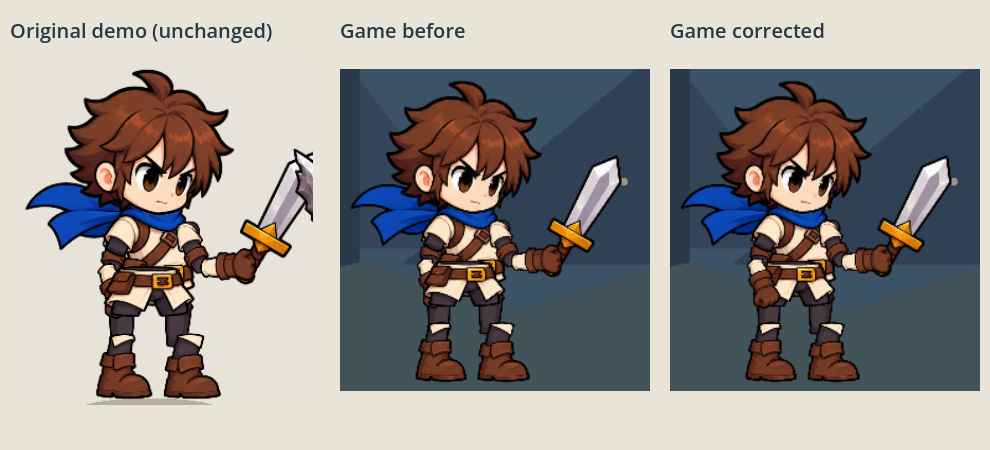

# Visual integration review — character rigs

Status: focused presentation correction, **not approval to merge**. No gameplay,
balance, combat architecture or branch integration changes.

## Rendered evidence

Captured with actual Godot 4.7.2 OpenGL Compatibility, Mesa llvmpipe on Xvfb.
These are renderer screenshots, not generated artwork or Python pose approximations.



The comparison uses crops of the full screenshots below, scaled to fit labeled
panels; the artwork is unmodified. Before baseline is commit 0c744af.

- [Original standalone demo, unchanged](visual-evidence/source-demo-idle.png)
- [Game before correction](visual-evidence/game-before-idle.png)
- [Corrected idle](visual-evidence/game-after-idle.png)
- [Corrected attack windup, 0.18 seconds](visual-evidence/game-after-attack.png)
- [Corrected hit, 0.07 seconds](visual-evidence/game-after-hit.png)
- [Attack interrupted by hit](visual-evidence/game-after-interrupted.png)
- [Live combat: hero attack and target recoil](visual-evidence/combat-hero-contact.png)
- [Live combat: unchanged Alchemist and hero recoil](visual-evidence/combat-alchemist-hit.png)

The first six pose images use native AnimationPlayer sampling, with cue signals
blocked so the second actor cannot overwrite the selected comparison pose. They
are controlled pose comparisons, not claims of a naturally paused battle. The
last two are captured from the normal screen combat loop with seed 177 and real
impact callbacks. The demo was also run through the same idle/attack/hit/interruption
sampling and compared against the game before correction.

## Cause and focused correction

The affected arm is the **shield-side forearm**, named Art_far_forearm (screen left
on the unmirrored hero). Its supplied Z=3 places it behind torso Z=7 and pelvis Z=8.
The sword-side near upper arm/forearm already use Z=11/13 and are above the body.
Both supplied rigs share the faulty far-forearm ordering. It is visible in the
standalone Godot demo as well as the integrated game.

| Candidate cause | Finding |
| --- | --- |
| Rig asset setup | Confirmed: explicit far-forearm layer 3 is below torso/hip. |
| Scene/node order | Not the cause: these sprites have explicit distinct Z values. |
| Effective Z / wrapper | Stage offset -100 preserves relative ordering: forearm -97, torso -93, pelvis -92. Its purpose is keeping characters behind HUD/draft/log. |
| Animation tracks | No Z-order tracks; native position/rotation tracks move the forearm into the occlusion region. No animation tracks were changed. |
| Facing | Mirroring flips X, not near/far depth. Problem reproduces in both facings; swapping all layers on facing would be incorrect. |
| Integration code | It imported the source problem unchanged. Prior headless tests checked UI order, not body-part occlusion; that verification gap is now covered. |

Changed **only Art_far_forearm from Z=3 to Z=9** in each runtime scene and matching
runtime rig.json. This puts it above torso/pelvis (including optional chestplate
Z=8) and below shield Z=10. The far shoulder remains behind the torso, avoiding
an overlapping shoulder painted into the torso PNG. Joint hierarchies, native
animation resources, impact/completion/cancellation signals, facing, speeds,
textures and equipment attachment paths are preserved. The original standalone
pack remains unchanged as a reproducible source reference.

## Playback findings and ownership

- **Codex — corrected:** runtime forearm occlusion in both rigs. New layer tests
  sample both facings through idle, attack, hit, interruption and reset; full-screen
  overlay ordering remains tested separately.
- **Codex — remaining presentation issue:** current arena spacing at scale 0.9
  gives weak weapon/body contact. The live combat screenshot shows recoil while
  the sword is still short of the torso. Demo actors are closer relative to their
  scale (290/1.15 vs game 305/0.9). This is scene spacing/approach choreography,
  not damage timing. This pass does not change spacing, add substitute attack
  tweens or claim contact polish is resolved.
- **Art Department — source correction:** upstream far_forearm layer should be
  above the pelvis/torso and below its shield, in rig definitions and generated
  scenes. Keep far shoulder behind torso. PR #4's original demo still reproduces
  the old occlusion; rebuilding/copying it without this correction restores the bug.
- **Art Department — source limitations:** torso texture includes a shoulder/sleeve
  and belt while separate upper-arm and pelvis textures contain overlapping pieces.
  Body rotates independently of pelvis, exposing cutout seams/overlap in stronger
  poses. Request clean segmentation/pivots and a pose review of shoulder, waist,
  wrist/weapon transitions. Do not solve this by redrawing or flattening the rig
  in integration code. No walk/death/turnaround clips were supplied.

No new controller/track interruption bug was found in the sampled attack-to-hit
and attack-to-idle transitions. That does not establish every possible animation
combination is polished. Linux software rendering was visually inspected; director
approval and Windows/mobile graphical review remain outstanding.

## Reproduce and verify

With a graphical display and Godot 4.7.2, from the game root:

```sh
godot --path . --rendering-method gl_compatibility --script res://tools/capture_rigs.gd -- game /absolute/output
godot --path . --fixed-fps 60 --rendering-method gl_compatibility --script res://tools/capture_rigs.gd -- combat /absolute/output
```

For the unchanged demo use `--path art/character_pack` and the absolute path to
`tools/capture_rigs.gd`, with mode `demo`. Mode `comparison` reads the three saved
idle screenshots from the evidence directory and produces the labeled comparison.
Run `GODOT_BIN=/path/to/godot bash tools/test.sh` for all nine game/rig suites.
